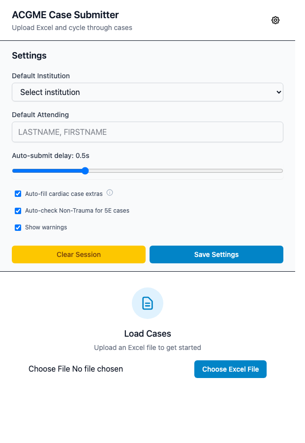
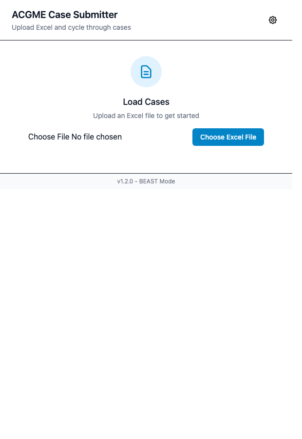
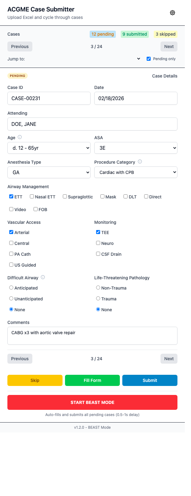
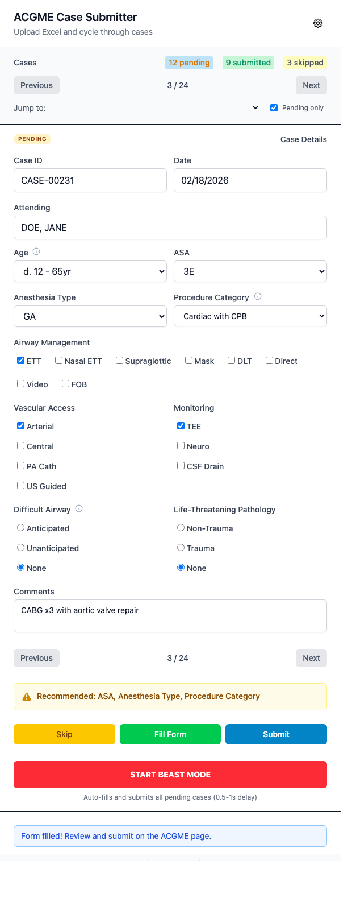

# ACGME Case Submitter User Guide

Version: `1.5.1`

## 1. What this extension does

ACGME Case Submitter helps you import standardized case log spreadsheets and
fill the ACGME Case Entry form on:

- `https://apps.acgme.org/ads/CaseLogs/CaseEntry/*`

## 2. Compliance and authorization

- This extension is **not affiliated with, endorsed by, or sponsored by ACGME**.
- You must use it only with authorized ADS credentials and institutional
  approval.
- You are responsible for the following:
  - `https://www.acgme.org/about/legal/terms-of-use`
  - `https://apps.acgme.org/ads/` (including ADS-specific policies)
- ACGME Terms include restrictions on unauthorized access and use of automated
  tools to monitor/copy site content. Obtain institutional and/or ACGME
  approval before using automation features.
- This guide is the operational documentation, not legal advice.
- No disclaimer can guarantee compliance by itself. Your account rights,
  institution policy, and ACGME terms control permitted use.
- For repository-level compliance language, see `wiki/Compliance-and-Disclaimers.md`.

## 3. Requirements

- Google Chrome (current stable)
- Access to ACGME Case Entry
- Spreadsheet file in `.xlsx`, `.xls`, or `.csv` format with required columns

Required columns for the main case log:

- `Case ID`
- `Case Date`
- `Supervisor`
- `Age`
- `Original Procedure`
- `ASA Physical Status`
- `Anesthesia Type`
- `Procedure Category`

Optional columns:

- `Airway Management`
- `Specialized Vascular Access`
- `Specialized Monitoring Techniques`

Separate OB, block, and procedure files use `Procedure Name` instead of
`Anesthesia Type`. For these files, `Age` and `Primary Block` are optional;
the other required columns above still apply. The extension detects this layout
from the headers when format metadata is absent, including CSV uploads. You do
not need to add an `Anesthesia Type` column to a standalone export.

## 4. Installation

### Option A: Install from Chrome Web Store (recommended)

1. Open the extension listing in the Chrome Web Store.
2. Click `Add to Chrome`.
3. Confirm installation.
4. Pin the extension from the Chrome toolbar for quick access.

### Option B: Install unpacked from this repository

1. Open a terminal in the repository.
2. Build the extension:

```bash
bun install
bun run build
```

3. Open `chrome://extensions`.
4. Enable `Developer mode`.
5. Click `Load unpacked`.
6. Select the repository `dist/` folder.

## 5. First-time setup

1. Navigate to the ACGME Case Entry page and keep that tab open.
2. Click the extension icon in the Chrome toolbar.
3. Click the gear icon to open settings.
4. Optionally set:

- Default Institution
- Default Attending
- Auto-submit delay
- Cardiac autofill and 5E options

5. Click `Save Settings`.



## 6. Load your case file

1. In the case window, click `Choose Excel File`.
2. Select your `.xlsx`, `.xls`, or `.csv` file.
3. Confirm the case counter appears, and the first case loads.



## 7. Review and process each case

1. Use `Previous`, `Next`, or `Jump to` to navigate.
2. Review and adjust any field values before submission.
3. Choose one action:

- `Fill only`: fills the ACGME form. Choose `Open ACGME`, review and submit on
  that page, then choose `Mark submitted` in the case window to move to the next case.
- `Fill & submit`: fills, submits, and checks that ACGME saved the case.
- `Skip`: marks the case as skipped and moves to next pending case.



Validation and status messages appear in the case window.



## 8. Submit pending cases

Use `Submit pending cases` to process pending cases, starting at the case you
are viewing and wrapping around to earlier cases. Submitted, skipped, and
Needs review cases are excluded.

- The toolbar icon opens a separate case window. Switching tabs or clicking the
  ACGME page keeps the batch running. Closing the case window stops the batch.
- The window stays connected to the ACGME tab it opened from. `View ACGME`
  returns to that tab, and clicking the extension icon brings back the same window.
- Progress remains visible; use `Stop` or `Stop batch` to finish later.
- The batch pauses for fields you need to correct. Choose `Continue batch`
  after making changes, or stop and resume later.
- The extension waits for the entry form to be ready and honors your configured
  delay before each submission. It adds no fixed pauses between cases.
- Use a new case entry form. If the connected tab is editing an existing case,
  the extension asks you to open a new form and leaves the existing case untouched.

### When a case needs review

A submission interrupted after clicking may already be saved. Its `Needs review`
status is retained when you reopen the case window and prevents automatic resubmission.
An error message remaining on the page does not prove that a save failed.
Use the `to review` counter to jump to these cases.

- `Check save` looks for the saved case without submitting again. It uses the
  original ACGME tab and recent-case list; an older save may need manual checking.
- Expand `Update status manually` only if you need to resolve the outcome yourself.
  Choose `It was saved` or `Not saved — allow retry` after checking ACGME.

Completed cases show a compact status. Expand `Change status` to correct a
submitted case, or `Undo skip` to return a skipped case to pending. The `Unfinished` filter includes
pending and Needs review cases, plus the case currently displayed.

If progress cannot be saved on your device, a persistent message offers
`Retry saving`. Automatic submission stops until it can record recovery details.

## 9. Troubleshooting

### The connected ACGME tab is unavailable

- Open Case Entry in the tab connected to the case window.
- If that tab was closed, close the case window and click the extension icon
  from an ACGME Case Entry tab. Your case edits and progress are retained.
- Opening another tab during a batch does not change its destination.

### “Content script not loaded” message

- Refresh the ACGME page
- Reopen the extension case window and retry

### Missing columns error during upload

- Verify exact header names against section 3
- Remove extra header rows above the real column header row

### Attending not found

- Confirm exact `LASTNAME, FIRSTNAME` format
- Set a Default Attending in settings

## 10. Data and privacy

- Files are parsed locally in your browser case window.
- Settings and session progress are stored in Chrome storage.
- The extension uses no external API calls or telemetry.

See `PRIVACY.md` for details.

## 11. Export this guide to PDF

Example with Pandoc:

```bash
pandoc USER_GUIDE.md -o USER_GUIDE.pdf
```

If you want embedded images in the PDF, run the command from the repository root
so relative image paths resolve correctly.
